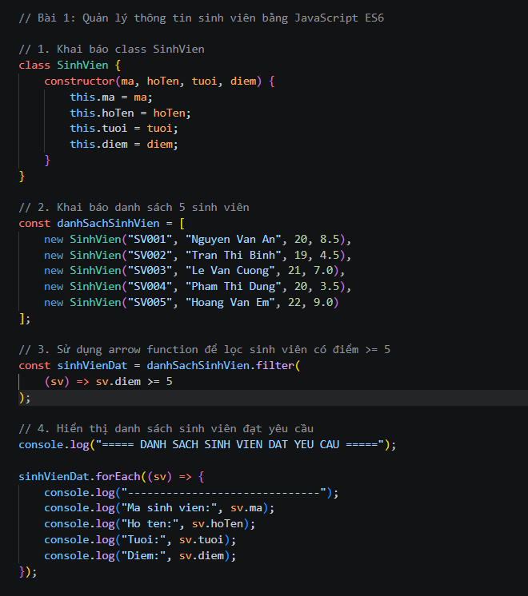
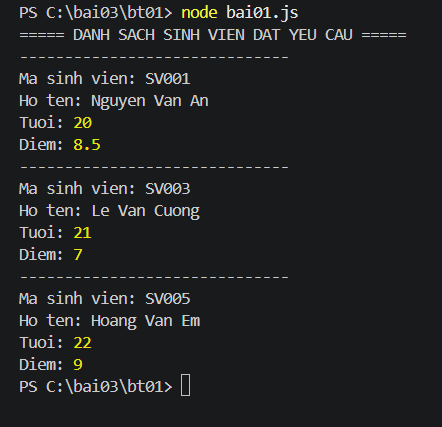

# BÀI 1: QUẢN LÝ THÔNG TIN SINH VIÊN BẰNG JAVASCRIPT ES6

## 1. Giới thiệu
Bài thực hành sử dụng JavaScript ES6 để quản lý
thông tin sinh viên.

Các kiến thức được sử dụng:
- Class và Constructor.
- Mảng đối tượng.
- Arrow Function.
- Hàm filter().
- Hàm forEach().
- console.log().

## 2. Cấu trúc thư mục

```text
Bt01/
├── bai01.js
└── README.md
```

## 3. Các bước thực hiện

### Bước 1: Kiểm tra Node.js

```bash
node -v
```

### Bước 2: Chạy chương trình

```bash
node bai01.js
```

### Bước 3: Kiểm tra kết quả

Chương trình lọc danh sách sinh viên có điểm
lớn hơn hoặc bằng 5 và hiển thị thông tin
của các sinh viên đạt yêu cầu.

## 4. Kết quả

Có 3 sinh viên đạt yêu cầu:
- SV001 - Nguyen Van An - 8.5 điểm.
- SV003 - Le Van Cuong - 7 điểm.
- SV005 - Hoang Van Em - 9 điểm.

## 5. Hình ảnh minh chứng

### Hình 1: Cấu trúc thư mục


### Hình 2: Mã nguồn chương trình


### Hình 3: Kết quả chạy chương trình


## 6. Kết luận

Hoàn thành bài thực hành quản lý thông tin
sinh viên bằng JavaScript ES6.
