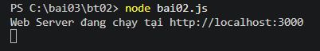
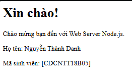
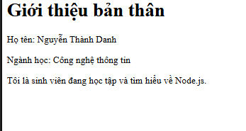
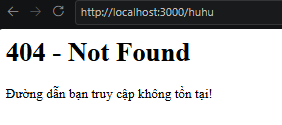

# BÀI 2: TẠO WEB SERVER VỚI NODE.JS

**Họ và tên:** Nguyễn Thành Danh

**Môn học:** Node.js

## 1. Giới thiệu bài thực hành

Bài thực hành xây dựng Web Server cơ bản bằng Node.js sử dụng module `http`.

## 2. Yêu cầu

- Sử dụng module `http` tạo Web Server tại cổng 3000.
- Truy cập `/`: Hiển thị lời chào và mã sinh viên.
- Truy cập `/about`: Hiển thị thông tin giới thiệu bản thân.
- Đường dẫn không tồn tại: Trả về mã trạng thái HTTP 404.

## 3. Cấu trúc thư mục

```text
Bt02/
├── bai02.js
└── README.md
```

## 4. Các bước thực hiện

**Bước 1: Kiểm tra Node.js**

```bash
node -v
```

**Bước 2: Khởi chạy chương trình**

```bash
node bai02.js
```

**Bước 3: Truy cập trang chủ**

```text
http://localhost:3000
```

**Bước 4: Truy cập trang giới thiệu**

```text
http://localhost:3000/about
```

**Bước 5: Kiểm tra lỗi 404**

```text
http://localhost:3000/test
```

## 5. Hình ảnh kết quả

### Ảnh 1: Chạy Web Server trên Terminal



### Ảnh 2: Kết quả trang chủ



### Ảnh 3: Kết quả trang About



### Ảnh 4: Kết quả đường dẫn 404



## 6. Kết luận

Sau khi hoàn thành bài thực hành, em đã biết cách:

- Sử dụng module `http` trong Node.js.
- Tạo và khởi chạy Web Server tại cổng 3000.
- Xử lý các yêu cầu HTTP bằng `req.url`.
- Trả về nội dung HTML cho trình duyệt.
- Xử lý mã trạng thái HTTP 200 và 404.

**Bài thực hành đã hoàn thành.**