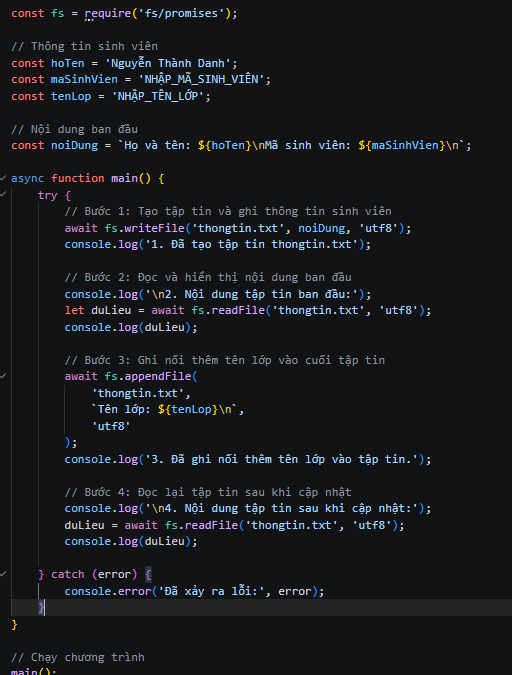
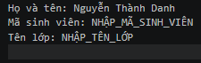

# BÀI 3: THAO TÁC TẬP TIN BẰNG FILE SYSTEM

**Họ và tên:** Nguyễn Thành Danh

**Môn học:** Node.js

## 1. Giới thiệu bài thực hành

Bài thực hành sử dụng module `fs` trong Node.js để thao tác với tập tin, bao gồm tạo tập tin, đọc nội dung và ghi nối thêm dữ liệu.

## 2. Yêu cầu bài thực hành

- Sử dụng module `fs`.
- Tạo tập tin `thongtin.txt` chứa họ tên và mã sinh viên.
- Đọc và hiển thị nội dung tập tin lên Terminal.
- Sử dụng `appendFile()` để ghi nối thêm tên lớp.
- Đọc lại tập tin để kiểm tra nội dung sau khi cập nhật.

## 3. Cấu trúc thư mục

```text
Bt03/
├── bai03.js
├── thongtin.txt
├── README.md
└── images/
    ├── buoc1.png
    ├── buoc2.png
    ├── buoc3.png
    └── ketqua.png
```

## 4. Các bước thực hiện

### Bước 1: Kiểm tra Node.js

Mở Terminal và nhập lệnh:

```bash
node -v
```

### Bước 2: Chạy chương trình

```bash
node bai03.js
```

### Bước 3: Tạo tập tin thongtin.txt

Sử dụng hàm `writeFile()` để tạo tập tin và ghi thông tin sinh viên.

### Bước 4: Đọc nội dung tập tin

Sử dụng hàm `readFile()` để đọc và hiển thị nội dung lên Terminal.

### Bước 5: Ghi nối thêm tên lớp

Sử dụng hàm `appendFile()` để thêm tên lớp vào cuối tập tin.

### Bước 6: Đọc lại tập tin

Sử dụng `readFile()` để kiểm tra nội dung sau khi cập nhật.

## 5. Hình ảnh kết quả

### Ảnh 1: Chạy chương trình Node.js



### Ảnh 2: Tạo và đọc tập tin thongtin.txt



## 6. Kết luận

Sau khi hoàn thành bài thực hành, em đã nắm được cách:

- Sử dụng module `fs` trong Node.js.
- Tạo và ghi dữ liệu vào tập tin bằng `writeFile()`.
- Đọc nội dung tập tin bằng `readFile()`.
- Ghi nối thêm dữ liệu bằng `appendFile()`.
- Kiểm tra nội dung tập tin sau khi cập nhật.

**Bài thực hành đã hoàn thành.**